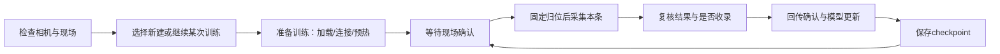

# GUI使用流程方案（待讨论，未实施整体界面调整）

更新：2026-11-02（Asia/Shanghai）。用户明确要求先提供详细方案，再调整整体界面。本文是待讨论的产品/操作方案；本轮仅修复预览、预热和错误状态，**不合并按钮、不自动启动新实验、不自动开始机器人运动**。

## 目标、输入输出与边界

目标是让操作员始终知道：现在在哪一步、是否会运动、需要自己做什么、正在等待什么、数据是否已经用于更新、哪里可以继续上次训练。

输入包括已确认的数据/归一化资产、RTC权重或某次GUI-RL的完整checkpoint、现场客户端配置、常驻双相机与CAN反馈，以及每条回合的人工就绪/复核结果。输出包括本地轨迹、服务端准入ACK、模型更新计数、checkpoint保存步数和可恢复实验列表。

机器人动作、成功检测、原采集预检与现场监护要求保持现有合同。运动只由现场人员明确确认后开始。模型加载、推理预热、查看图像和选择历史实验本身不应发送机器人目标。故障后不自动重发动作，也不自动从中断的半条rollout继续。

## 建议的主流程

“准备训练”合并自动启动/连接的建议尚未获准实施，当前仍保留原来的服务器启动和连接两个按钮。每条回合仍单独人工确认，不因为模型准备好就自动运动。

| 步骤 | 操作员做什么 | 系统自动做什么 | 可见完成标志 | 失败时怎么办 |
| --- | --- | --- | --- | --- |
| 1. 现场检查 | 确认现场监护、物体、路径与急停；检查双相机画面 | 相机持续采集，显示故障；只读获取所需反馈 | 两路画面新鲜，现场确认已勾选 | 相机失效先处理设备；不启动策略；CAN恢复需明确点击恢复使能 |
| 2. 选择实验 | 新建训练，或选一个可恢复的历史GUI实验；续训时填追加动作预算 | 核对配置、模型checkpoint、同step复核状态和原W&B身份 | 显示实验名、保存步数、更新次数；无保存点明确说明 | 不把旧日志/轨迹当作可恢复模型；不可恢复项不能启动续训 |
| 3. 准备训练 | 当前先启动服务器，再连接；未来可讨论合并为一个按钮 | 检查GPU/端口/资产，读取示教、加载模型、构建学习器，预热首次和RTC推理，测稳定延迟 | 按实际阶段显示进度；完成后才等待现场归位确认 | 显示第一个错误；服务器已退出则结束等待，不能无限“连接中” |
| 4. 开始本条 | 人工复位物体、确认路径，点击归位并开始 | 重新检查反馈与起点，固定低速关节归位，确认到位后开始策略与记录 | 明确分开“归位中”和“采集中”，步数开始增加 | 起点范围错误可现场调整后重试；反馈/控制故障停止，不绕过检查 |
| 5. 结束本条 | 正常到达成功/步数上限，或点击结束本条并复核 | 不再派发下一条策略目标，完成本条记录；常驻相机继续 | 显示本条长度、自动结果、待复核状态 | 普通结束不等于急停；突发情况使用急停，不为保留数据延迟停止 |
| 6. 复核 | 保留自动结果或改为成功/失败，决定收录或拒收 | 发送回合摘要与标签，服务器核对长度/摘要后持久化、入池并ACK | 显示已收录/已拒收；ACK不是模型更新或保存 | 未ACK仍显示待确认，不直接开始下一条，也不重复提交不确定结果 |
| 7. 更新与保存 | 等待；不需要再点“学习” | 满足冷启动/样本门槛才更新，记录loss/lr/指标；完整回合后保存 | 分别显示收录条数、更新次数和最后保存步数 | 保存失败明确提示可恢复边界；不要把已收录等同于已保存模型 |
| 8. 下一条或结束 | 继续则重新摆放物体并确认；结束则在保存完成后停止训练 | 回到等待现场确认；结束时保留实验和保存点 | 不会自行进入下一条运动 | 急停后新建机器人会话，从完整checkpoint恢复，不接着半条动作继续 |

## 三个容易混淆的状态

1. **已收录轨迹**：服务端已经持久化并准入。拒收轨迹保留本地档案，但不进入经验池、不产生更新额度。
2. **已完成模型更新**：模型参数确实执行了更新。当前GUI驱动至少累计10条收录回合、动作步数满足batch要求后才进入更新；前几条更新次数为0可能是正常冷启动，必须显示原因。
3. **已保存checkpoint**：模型与同step复核训练状态保存完成。只有这些保存点能用于续训；仅有W&B记录或ACK不足以恢复模型。

建议服务器面板固定显示这三组计数，保存过程中显示“正在保存”；不要只用一个笼统的“运行中”。本轮已补充阶段/计数支持，但不重排整个界面。

## 新建与续训的操作合同

| 项目 | 新建训练 | 继续已有训练 |
| --- | --- | --- |
| 模型起点 | 配置指定的RTC权重 | 所选实验最近的完整RL checkpoint |
| 实验身份 | 新run_name和W&B身份 | 保留原run_name、输出目录与W&B身份 |
| 模型/经验/计数 | 新的在线经验与更新计数 | 恢复checkpoint覆盖的已收录经验、更新额度和更新计数 |
| 动作预算 | 新实验max_steps | 总预算取原预算与“保存步数+追加步数”的较大值 |
| 现场状态 | 必须重新确认并归位 | 同样重新确认并归位，不能直接接着旧目标运动 |
| checkpoint后未覆盖的轨迹 | 不适用 | 按原逻辑隔离，客户端原始档案保留，不混入另一恢复分支 |

若希望“只增加剩余1000步”而不是当前的总预算语义，建议下一轮改为清楚的“本次续训再运行N步”，并在确认区域同时显示起点与终点；这涉及预算语义调整，先讨论后实现。

## 停止与异常恢复

- **结束本条并复核**：常规结束当前rollout，保留本条用于复核，之后更新/保存并等下一次人工确认。最后下发的硬件目标可能仍需完成，不替代紧急制动。
- **急停按钮/Esc**：优先停止本机，禁止后续目标，使用新鲜反馈保持当前位置，失败时阻尼急停；本条中断不入池。当前实现会结束学习器会话，不承诺额外保存最后更新。页面必须有键盘焦点才能收到Esc。
- **停止训练服务**：正常结束训练宜等回合复核和保存完成再操作；仍先保证本机停止。保留已有保存点，下一次显式选实验续训。
- **浏览器/模型/CAN/相机故障**：显示具体原因和发生阶段，不自动重放旧动作。模型首次编译在运动前完成；运行中动作看门狗继续生效。

建议将“正常暂停在回合边界”和“急停”分清；不要为了避免模型重载，把急停改成自动重连旧控制会话。若希望异常后保持学习器驻留，需要单独设计可确认的恢复协议，不能靠重发RPC实现。

## 拟议界面组织（未实施）

- 顶部：全局急停、当前实验名、当前步骤、明确下一步；故障信息优先显示根因。
- 主区：双路常驻预览、当前回合步数与检测结果；开始/结束本条的主要操作。
- 准备区：新建/续训选择、服务器加载/预热阶段、最近保存点；高级日志可展开。
- 复核区：标签、收录开关、提交及ACK状态；回放历史时明确不修改当前回合。
- 独立机械臂操作放在折叠的现场操作区，明确与策略会话互斥，减少将手动归位与回合归位重复点击的混淆。

## 待与你讨论的选择

1. 是否将“启动服务器+连接学习器”合并为“准备训练”，保留高级分步按钮？本轮按你的要求暂不合并。
2. 默认继续逐条人工复核，还是在稳定后使用自动收录？当前默认逐条复核保留，任何模式下下一条运动仍需人工确认。
3. 是否需要一个“本条完成并保存后停止训练”的正常收尾按钮？它应等待本条复核/保存，不改变急停的立即性。
4. 续训预算使用“再运行N步”还是“至少到总步数N”？建议改为前者，但需确认。

## 验收与分阶段实施

先修复当前卡顿/RTC首次编译/故障提示，进行软件回归和GPU只读推理。方案确认后再调整界面；使用模拟环境验收全流程、人工拒收、自动模式、停止恢复和历史续训。最后由现场人员验收实际归位、短回合、模型更新/保存及续训；软件模拟和GPU预热都不能替代真机验收。
