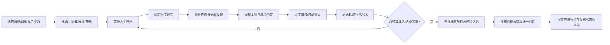

# GUI使用流程与约定

更新：2026-11-02（Asia/Shanghai）。当前合同按用户最新确认改为**整轮采完后统一整理、训练、保存**。每条仍由人工决定开始，默认系统判定＋逐条人工审核，自动收录可选。原逐条更新/保存流程仅作为[历史记录](历史/设计/2026-11-02_GUI流程落地.md)。

## 目标、输入输出与边界

目标：去掉回合之间的完整模型保存等待，避免上一条夹持状态导致新一条误判；明确区分原始归档、经验入池、梯度更新和模型保存。

输入：已确认的数据与归一化资产、RTC权重或完整GUI-RL checkpoint、现场客户端配置、双相机/CAN反馈、人工开始与复核结果。输出：客户端HDF5、服务器原始批次归档、最终已准入经验、更新计数和完整模型保存点。

推理仍在4090，动作/观测必须实时通过有线WebSocket往返，无法推迟到采完后。在线轨迹不经过LeRobot或全成功示教转换器，也无需重复上传图像；训练用标签整理、入池和梯度更新统一在整轮结束后执行。

## 保存模型与只推理

GUI可选择继续训练或“使用已保存模型·只推理不训练”。只推理固定读取完整RL保存点，先预热、每条人工确认归位张开，不进入训练经验池、不执行update、不保存新权重，结果写独立evaluations目录。操作与权重分区见[模型权重管理与使用](模型权重管理与使用.md)。

保存保持低频：每条采集不保存模型，整轮采集与更新结束后只保存一次；正常结束训练确保最终完整保存点，急停不强制额外保存。

## 当前主流程

“准备训练”不会运动。每条点击“现场就绪，归位、张开夹爪并开始”后，先执行原10%速度固定关节归位，再张开至客户端配置的夹爪宽度上限（正式0.10m）。归位配置可显式设置`gripper_open_width_m`；默认容差0.002m、等待5秒。必须取得指令下发之后的新鲜米制宽度反馈，才能创建录制器、清空检测器历史并开始策略。归位和张开都不进入rollout/replay；超时、过期反馈、单位异常或停止会阻止开始。

## 回合与整批的状态

| 状态 | 含义 | 能否继续下一条 |
| --- | --- | --- |
| 待复核/已提交 | 原始文件已完成，标签未确认或服务端尚未ACK | 否 |
| 已归档·等待整批训练（queued） | 服务端已核验摘要并保存本条原始轨迹；尚未入池、更新或保存模型 | 是，仍须人工确认 |
| 已拒收 | 保留客户端原始档案和服务端审核信息；无入池、无更新额度 | 是，仍须人工确认 |
| 已加入经验（accepted） | 整轮结束后已按最终标签入池并保存经验归档 | 已进入整批处理，不再采集 |
| 更新计数/模型保存点 | 分别代表真实梯度更新次数、完整模型及同step复核状态保存完成 | 正常完成后可显式续训 |

至少累计10条收录回合、步数满足batch条件才产生更新；沿用原每30个合格收录步一次外层update和原UTD。前9条不追补额度，拒收不产生或触发更新额度。整轮结束时不足门槛，界面明确显示跳过更新并保存，不能宣称训练成功更新过模型。此修改只改变采集/训练时序，不修改上游算法、动作表示或奖励规则。

## 结束采集、急停与恢复

- **结束本条并复核**：仅结束当前rollout；审核归档后可继续下一条，不会启动整批训练。
- **结束采集并训练**：本条自然结束（也可提前结束本条）并完成审核后，处理整轮所有已归档数据、训练和保存；等待下一次开始时点击则不再归位。达到总动作预算自动执行相同流程。
- **急停/Esc/立即结束训练服务**：先停止本机并禁止后续目标，不等待审核、训练或额外保存；不自动重连或重发动作。不能用来代替正常结束采集。
- 保存失败不会报告正常完成。只有完整模型checkpoint、同step`review_state_<step>.json`和原W&B身份可用于GUI续训；总步数必须大于保存点。

服务器采集暂存放在`checkpoints/collection_batches/<batch_id>/reviewed_episodes/`，与模型恢复使用的`checkpoints/reviewed_episodes/`隔离。每条原始轨迹落盘后才发queued ACK；整轮结束后按序读取，每次只装载一条，避免把整轮图像堆在内存。未训练完的批次不会被恢复逻辑误当作checkpoint覆盖经验。原始批次保留供排查，暂不提供自动导入未完成批次的按钮；急停后需核对档案，不承诺自动续采/补训。

## 界面和验收

面板保留总动作预算、累计动作步、本条步数、收录/更新计数和最近模型保存点，增加已归档/整批整理/更新进度及等待原因。采集期间最近保存点不会逐条前移。相机预览继续独立20Hz取图。

本轮根因：现场日志显示第413/419步checkpoint分别保存70.05/67.46秒，总写入约18.4GiB；当时累计收录2条、更新0次，长等待主要来自逐条全模型保存。证据和软件验证见[本轮记录](历史/数据与控制/2026-11-02_整批采集训练与夹爪复位.md)。软件模拟不能替代真实归位/张开、完整模型更新和现场成功率验收。
