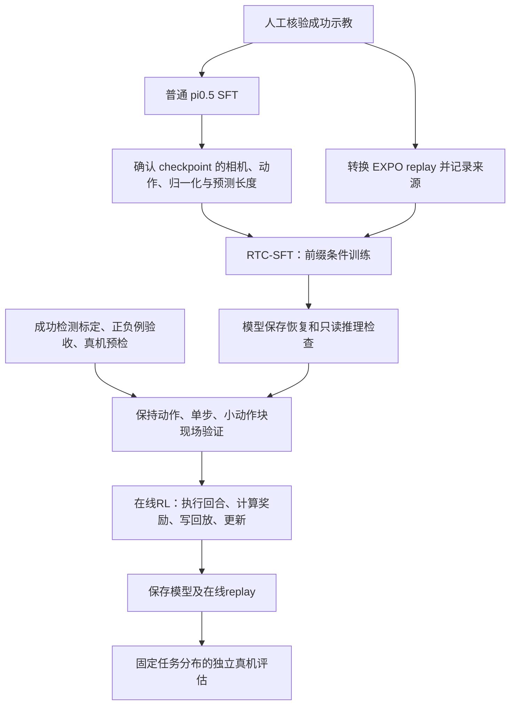

# Piper-X Real-Time EXPO-FT 完整训练流程

日期：2026-10-30（Asia/Shanghai）。任务：`grab the rotating red square`。

本文是独立的训练与真机启动说明。工程部署记录、每轮实际执行结果分别见 `真机RL配置执行记录.md` 和 `项目交接.md`。下面的启动命令包含会使能、运动或训练的步骤；这些命令作为操作说明列出，不表示本次已经执行。

## 1. 全流程与各阶段的产物



| 阶段 | 输入 | 输出 | 通过标准 |
| --- | --- | --- | --- |
| 普通 SFT | 成功示教、pi0.5初始权重 | 会做本任务的 pi0.5 checkpoint | 能加载、推理，任务已有一定成功率 |
| 接入兼容检查 | 训练配置、checkpoint、norm、示教 | 一致的模型/动作/相机配置 | 参数形状、坐标转换和相机身份一致 |
| RTC-SFT | 上述checkpoint、EXPO示教回放 | 经过前缀条件训练的VLA参数 | loss/lr有限、保存恢复成功、前缀推理验证通过 |
| 真机现场验收 | 成功检测器、工作空间、传感器、模型 | 可控且奖励可靠的现场流程 | 正负例判定、单步动作和延迟实测通过 |
| 在线 RL | RTC-SFT参数、成功示教、真机反馈 | critic、edit policy、VLA及在线回放 | success/return/loss/lr有效、保存恢复通过 |
| 独立评估 | 已保存RL checkpoint、固定评估分布 | 成功率、延迟、失败类别 | 人工复核成功，不能仅用自动奖励自证 |

普通SFT、RTC-SFT和在线RL是不同阶段。普通SFT模型已经训练完成，并不代表做过前缀条件训练或真实强化学习；GPU小算子通过也不代表完整模型能训练。

## 2. 本次选择的已训练模型

- 实验：`pi05_lora_batch2345_h30_10k_20261025`。
- 训练配置身份：`pi05_piper_10_25_batch2345_h30_lora`。
- 使用step：`10000`；服务器记录中的模型步数和两个优化器计数均为10000。
- 数据：batch2+3+4+5，共394条、44721帧、30Hz；用户已明确确认全部为成功示教。
- 模型预测长度：30帧；实际每次重规划执行8帧，二者不是同一个参数。
- 图像：前视 `base_0_rgb`、真实右腕 `right_wrist_0_rgb`；左腕槽位为空且掩码为False。
- 外部状态/动作：7维 `[x,y,z,roll,pitch,yaw,gripper_width]`，位置和夹爪为米，角度为弧度；目标为机器人基坐标系的绝对法兰位姿。
- 原普通SFT在模型内部对前6维使用相对当前观测的delta，夹爪仍是绝对宽度；不能把delta直接发给机器人。

4090上的原始权重：

```text
/data/gcj_data/fast/baseline/openpi/trained_model/checkpoints/
  pi05_piper_10_25_batch2345_h30_lora/
  pi05_lora_batch2345_h30_10k_20261025/10000/params
```

路径在实际YAML中为连续的一行。原权重、原训练配置及原归一化文件只读使用，不覆盖。

### 为什么增加动作适配

EXPO的replay会把多个时刻的动作拼成一个chunk。如果每一帧提前减去各自的状态，拼出的delta就具有不同参考原点；此外，上游输出反变换使用零占位state，不能直接承担原checkpoint所需的绝对位姿还原。

本项目因此采用以下边界，保持上游算法源码不改：

1. replay、critic、edit policy和RTC缓存前缀始终使用归一化后的**绝对动作**。
2. VLA训练前，把整个chunk的前6维统一减去该chunk观测的位姿，再按原checkpoint的delta统计归一化。
3. VLA预测后，按原统计还原delta，再加回生成该chunk时的观测位姿，转回绝对动作空间。
4. 下一次RTC推理的观测发生变化时，将绝对前缀重新转换到新观测的delta坐标。
5. 原checkpoint的state归一化保留不变；真实右腕仍进入原训练所用槽位。

实现位于 `src/piperx_expo/server/checkpoint_adapter.py` 和 `checkpoint_config.py`。`checkpoint_profile: piper_delta_right_wrist` 显式启用；旧配置继续使用旧适配。

## 3. 两台机器及配置位置

| 角色 | SSH | 工程根目录 | 有线地址 |
| --- | --- | --- | --- |
| GPU服务器 | `gh4090piper` | `/data/gcj_data/rl/real_time_expo_ft/code` | `192.168.50.2` |
| 机器人客户端 | `piperx` | `/home/cv/gcj/rl/baseline/realtime_expo_ft` | `192.168.50.1` |

训练协议使用 `192.168.50.2:8103`，与已有GUI推理服务的18765端口不是同一个服务。开始真机控制前，应退出占用CAN或相机的其他GUI、遥操和采集程序；不要同时运行两个控制客户端。

本次新增：

- 服务器：`configs/server/rotating_square.h30.yaml`。
- 客户端：`configs/client/rotating_square.calibrated.yaml`。
- 客户端原采集配置：`configs/local/collection.yaml`，包含CAN、相机序列号、零工具偏移；保持自动初始位姿运动关闭。

默认开发/演示YAML没有被替换。现场需要修改参数时，将本次配置复制到 `configs/local/`，并在所有命令中使用同一个本地配置路径。

环境分别为根轻量测试、客户端Python3.10、服务器Python3.11；用各自的 `uv run --locked`，不要合并环境。本次服务器锁定PyArrow19.0.1，修复原PyArrow26 wheel与NumPy1.26.4的实际导入冲突。

## 4. 准备成功示教和资产

本次已有LeRobot v2.1数据，无需重新采集或重新下载基础模型。源数据：

```text
/data/gcj_data/fast/baseline/openpi/data/derived/data_10_25_batch2345
```

服务器导入命令如下。**本次已完成；不要对相同输出目录重复执行。**需要重建时使用新的回放和资产版本名，并同步修改YAML。

```bash
cd /data/gcj_data/rl/real_time_expo_ft/code
uv run --project server --locked python -m piperx_expo.data.import_lerobot \
  --source /data/gcj_data/fast/baseline/openpi/data/derived/data_10_25_batch2345 \
  --output /data/gcj_data/rl/real_time_expo_ft/data/expo_batch2345_v1 \
  --checkpoint-norm /data/gcj_data/fast/baseline/openpi/trained_model/checkpoints/pi05_piper_10_25_batch2345_h30_lora/pi05_lora_batch2345_h30_10k_20261025/10000/assets/piper/data_10_25_batch2345/norm_stats.json \
  --assets /data/gcj_data/rl/real_time_expo_ft/assets/piperx/batch2345_h30_v1 \
  --confirm-successful-demos
```

输出及作用：

| 位置 | 作用 |
| --- | --- |
| `data/expo_batch2345_v1/<episode>/traj.hdf5` | 绝对动作、状态、两路RGB和任务指令 |
| `data/expo_batch2345_v1/manifest.json` | 源parquet哈希、帧数和成功确认记录 |
| `assets/piperx/batch2345_h30_v1/norm_stats.json` | 原state统计＋EXPO绝对动作统计 |
| 同目录 `vla_norm_stats.json` | 原checkpoint的state/delta动作统计 |
| 同目录 `provenance.json` | manifest及原统计哈希、动作适配版本 |

图像从原训练使用的224×224视频解码为RGB；不重新改变相机左右身份。导入不修改原parquet、视频或模型。EXPO reader对每条示教末帧赋奖励1，前面为0，所以失败示教不能不加区分地导入。

新采集数据仍可使用原 `piperx-convert` 路径；但本checkpoint profile必须同步建立匹配的双套动作归一化资产，不能直接用默认 `piperx-norm` 结果覆盖当前资产。

## 5. 先做软件与模型兼容检查

服务器执行：

```bash
cd /data/gcj_data/rl/real_time_expo_ft/code
uv run --locked python -m pytest -q
uv run --locked python scripts/smoke_rpc.py
uv run --project server --locked python scripts/validate_server.py
uv run --project server --locked python scripts/validate_checkpoint.py \
  --config configs/server/rotating_square.h30.yaml
bash scripts/server.sh sft --config configs/server/rotating_square.h30.yaml --dry-run
```

`validate_server.py`验证GPU小算子、原reader/replay及RTC控制流；`validate_checkpoint.py`验证真实checkpoint的参数形状、真实示教坐标变换、相机槽位和前缀重新锚定。它们不执行真实机器人动作，后者也不加载完整模型权重。

正式RTC-SFT前，还应在独立run中完成完整VLA的单步更新、checkpoint保存/恢复和只读推理。单步成功只证明链路可用，不能声称模型已完成RTC训练。

本次已在独立smoke run完成两步最小更新（中间保存/恢复一次），并从保存参数完成普通与5帧前缀推理。复查该验证权重可执行：

```bash
uv run --project server --locked python scripts/validate_checkpoint.py \
  --config configs/server/rotating_square.h30.yaml \
  --infer-weights /data/gcj_data/rl/real_time_expo_ft/runs/rotating_square_h30_smoke_20261030_sft/checkpoints/2/params
```

此选项会占用GPU加载完整模型，仍不会访问机器人；不要与其他大模型训练同时占用同一GPU。单候选、含首次编译的结果不能用于配置真实N=8推理的delay。

## 6. RTC-SFT：使已有模型适应前缀条件

普通SFT从噪声预测整个动作块；RTC-SFT在训练中随机保留一段干净的已执行动作前缀，只对后缀加噪声并计算损失，使部署时的前缀条件推理落在训练分布内。

本配置随机前缀长度为0～8，模型预测30帧，部署默认delay=5、replan_steps=8。初始化使用第2节已训练的10000-step普通SFT权重，模型的内部delta语义通过适配器保留。

服务器使用tmux启动离线RTC-SFT：

```bash
ssh gh4090piper
cd /data/gcj_data/rl/real_time_expo_ft/code
tmux new -s expo_rtc_sft
bash scripts/server.sh sft --config configs/server/rotating_square.h30.yaml
```

按 `Ctrl-b` 后按 `d` 可离开tmux，训练继续运行。重新查看：

```bash
tmux attach -t expo_rtc_sft
```

本配置batch=4、4000次离线梯度更新，每2000步保存。4000是初始计划，不是已验证的最优步数；依据留出轨迹、loss、推理和现场表现决定训练长度，修改时同步更新run_name及后续权重路径。

主要产物：

```text
/data/gcj_data/rl/real_time_expo_ft/runs/
  rotating_square_h30_20261030_sft/
    metrics.jsonl
    checkpoints/2000/...
    checkpoints/4000/params
```

训练结束后确认最终保存成功且目录完整。配置中的 `rtc_weights` 预先指向上述 `4000/params`；**完成该阶段之前，这个路径不存在，RL启动器会拒绝运行。**若最终采用其他step，必须修改 `rtc_weights`。

当前正式配置启用W&B在线记录，终端和metrics.jsonl同时记录loss/lr。启动器引用服务器已有`/data/gcj_data/fast/baseline/openpi/.wandb_env`中的凭据，不执行该文件里的shell命令、不复制密钥到项目。项目为`gongcj-beijing/piperx_realtime_expo_ft`，运行名称带`_sft`后缀；W&B随训练自动初始化，无需另开服务。恢复同一离线训练run：

2026-10-31服务器连通性验证仍返回HTTP403，尚未验证在线上传；应先按[快速开始](真机强化学习快速开始.md)中的认证检查排查可用网络/代理，再开始正式训练。配置不会静默改成offline。

```bash
bash scripts/server.sh sft --config configs/server/rotating_square.h30.yaml --resume
```

恢复前保持同一模型、相机、动作适配和归一化资产；若原run已经达到4000步，需要在本地配置里提高max_steps后再继续。不要覆盖原checkpoint。

## 7. 成功检测与真机预检

### 7.1 当前检测规则

复用官方“部分闭合＋抬高＋连续满足”的思路，适配Piper-X米制夹爪与示教保持目标：

$$
\text{condition}_t =
(z_t > 0.281807)
\land (0.0346 \le w_t \le 0.0386)
\land (0 \le w_t^{cmd} \le 0.0386).
$$

连续6个实际动作步满足后，返回success=True、reward=1并终止回合；其余reward=0。在30Hz正常节拍下对应约0.2秒，但代码按实际动作步数累计，不保证动作停顿时仍有相同墙钟持续时间。

阈值来自用户摆好的成功姿态：z=0.286807m、实际宽度0.0366m。高度下移5mm、宽度±2mm是本次明确选择的初始容差，**不是已经通过负例验证的最优阈值**。

另外只读扫描了394条已确认成功示教，380条曾连续6帧满足当前高度/实际宽度条件。该96.45%是离线几何覆盖，不含目标命令检查、没有负例，不能称为检测准确率；未命中的14条也没有被改标为失败。阈值是否需要调整，仍应由现场正负例验收决定。

Piper-X示教动作取下一帧反馈宽度，因此抓住物体后可能持续发送接近实际宽度的保持目标，不能照搬DROID的“闭合速度>0.5”。本适配检查实际宽度在物体区间且目标没有要求张开；不宣称测到了夹持力或证明夹爪堵转。

回合开始时没有策略动作，不能因为初始摆在成功姿态就直接记奖励；reset清空连续计数。同一步重复观测/信息RPC不增加计数。成功后保持终止结果，上游多发的终止后动作不会执行。

### 7.2 只读检查与奖励验收

客户端执行：

```bash
ssh piperx
cd /home/cv/gcj/rl/baseline/realtime_expo_ft
uv run --project client --locked python scripts/check_success.py \
  --config configs/client/rotating_square.calibrated.yaml
uv run --project client --locked piper-x-collect preflight \
  --config configs/local/collection.yaml
```

第一条只读取CAN反馈，不使能、发动作或急停；只验证高度/实际开度，不验证命令条件。第二条是原采集项目的只读硬件预检，需要原采集配置中的自动起始位姿运动保持关闭，并确保相机未被其他进程占用。

操作员应使用既有工具摆放以下姿态，分别运行只读检查并人工核验：

| 姿态 | 期望 |
| --- | --- |
| 抓住目标并抬起 | 几何条件满足；策略闭合/保持后能触发成功 |
| 抓住目标但未抬起 | 不成功 |
| 空夹闭合并抬起 | 不成功 |
| 夹爪张开并抬起 | 不成功 |
| 短暂经过高度/开度阈值 | 不满足连续6步则不成功 |

本规则不识别“红色”或物体身份；其他物体/卡住夹爪可能误报。如现场存在此风险，增加视觉证据再训练，不能用自动reward当作真实成功率的唯一依据。

### 7.3 控制与延迟验收

当前工作空间沿用同机已有GUI的现场配置：X[-0.02,1]、Y[-1,1]、Z[0,1]米。它不是无碰撞路径保证。EXPO仍保留10%速度、5mm单步位置限制、0.05rad旋转限制、5mm夹爪步长及0.5秒看门狗，没有照搬GUI的较大动作阈值。

真正开始策略动作前，按“保持目标→受限单步→短动作块”完成现场验证。如果策略首目标超过限制，应停下检查模型输出、坐标、归一化和现场起点；不要为了跑通而直接放大边界。

测量真实观测年龄、网络往返及VLA推理p50/p95。按

$$
delay = \lceil latency_{p95,s} \times control\_hz \rceil
$$

更新配置；当前5步只是假定的初始值。保持 `0 <= delay <= replan_steps`，且 `action_horizon >= 2 * replan_steps`。若p95超过8步（约267ms），当前配置不能覆盖延迟，先解决性能或重新设计参数；本次mock网络测试不能证明真机延迟满足要求。

## 8. 启动真实在线RL

只有前面模型和现场验收通过、`rtc_weights`已生成，才进入本节。**先把当前夹持抬起的成功样本姿态恢复成真实任务初始状态：目标放回旋转装置、夹爪与机械臂置于现场约定起点。**不要拿成功终态作为每回合起点。

### 8.1 先启动GPU学习器

```bash
ssh gh4090piper
cd /data/gcj_data/rl/real_time_expo_ft/code
bash scripts/server.sh rl --config configs/server/rotating_square.h30.yaml --dry-run
tmux new -s expo_rl
bash scripts/server.sh rl --config configs/server/rotating_square.h30.yaml
```

学习器先加载模型，再监听8103等待客户端。首次JAX编译可能较慢；客户端在第一条真实动作前不启动动作看门狗。

### 8.2 再启动机器人客户端

在机器人现场的交互终端执行：

```bash
cd /home/cv/gcj/rl/baseline/realtime_expo_ft
bash scripts/client.sh \
  --config configs/client/rotating_square.calibrated.yaml \
  --allow-motion
```

这条命令授权程序进入真实控制路径。每次reset都会等待操作员输入 `READY`，随后使能并设置速度；输入前确认物体已复位、起点正确且可执行动作。程序不会自动把物体抛到随机位置，也不会自动机械臂归位。

固定上游训练入口开始时会发送一次全零占位动作。对于Piper-X，这不是合法的绝对目标；客户端只忽略第一次启动占位，不发送CAN、不计步。正常策略动作仍按绝对位姿严格检查。

### 8.3 每个回合内部发生什么

1. 客户端读取RGB、绝对位姿和实际夹爪宽度，传回服务器。
2. VLA在后台提出候选动作块；到执行时刻，edit policy根据最新观测修正，critic选择动作块。
3. 客户端执行经工作空间和步长检查的绝对目标。
4. 下一次观测计算上一条动作的结果，附带 `success/reward/done/mask` 回传。
5. 成功奖励1并终止；200步仍未成功则以奖励0结束。客户端超时mask保持1，将其视为截断；本项目沿用的replay对跨截断窗口另有有效性屏蔽。
6. 本工程采用episode更新：回合结束后写入在线replay，再执行累积到期的梯度更新；人工复位可与服务器更新重叠。

上游先收集约10个在线回合作为预热，才开始更新，早期只有采集而无loss更新不一定是故障。`step_interval=30` 表示每收集约30条transition触发一次update调用；默认UTD=20意味着一次调用包含多次critic子更新，不能理解为每30步只做一次critic梯度。

`offline_ratio=0.0` 表示成功示教先灌入在线buffer，与新经验混合；不是不用示教。critic使用成功与失败数据；默认基础VLA的模仿更新只采样成功轨迹。

在线 `max_steps=4000` 指环境交互循环预算；离线SFT的同名字段指梯度更新数，含义不同。4000步在线预算只是初始试验规模，不保证论文级收敛。

## 9. 日志、保存、停止与恢复

在线产物：

```text
/data/gcj_data/rl/real_time_expo_ft/runs/rotating_square_h30_20261030_rl/
  metrics.jsonl
  train_videos/
  checkpoints/<step>/agent/...
  checkpoints/<step>/params/...
  checkpoints/buffers/<transition_step>.pkl
```

关注 success/return、critic loss、actor loss、lr、动作拒绝、相机/CAN过期、网络与采样延迟，以及显存峰值。正式配置W&B在线记录，运行名称带`_rl`后缀；打开训练终端打印的运行链接查看曲线。终端和本地metrics.jsonl保留；凭据只引用服务器本机文件，不写入Git。旧的通用示例仍默认offline，启动本次实验应使用`rotating_square.h30.yaml`。

RL保存的是完整学习器状态，`rtc_weights`只用于初次初始化VLA。恢复RL不能只提取其中VLA参数，否则critic、target、edit、优化器和replay状态会丢失。

停止时先让现场客户端停止并检查机械臂保持状态，再停止学习器。断线或动作错误会使客户端停止并退出/锁定；服务器适配禁用了上游自动恢复重发，避免无法确认动作是否已执行时重发历史目标。程序异常退出不保证自动保存最新一步，恢复以最后完整checkpoint为准。

确认现场及最后checkpoint/replay一致后，服务器恢复：

```bash
cd /data/gcj_data/rl/real_time_expo_ft/code
bash scripts/server.sh rl --config configs/server/rotating_square.h30.yaml --resume
```

然后重新运行第8.2节客户端，并按提示人工复位。不要直接重放断线前的动作队列，不设置无人值守自动重启。

## 10. 独立评估与实验记录

完成在线RL并保存完整checkpoint后，服务器执行：

```bash
cd /data/gcj_data/rl/real_time_expo_ft/code
bash scripts/server.sh eval --config configs/server/rotating_square.h30.yaml \
  --num_episodes=30
```

客户端仍使用第8.2节的真实控制命令和人工复位流程。评估默认加载 `eval_checkpoint_dir` 中最新完整RL checkpoint；固定某个step可增加 `--checkpoint_step=<实际step>`。评估会执行机器人动作，但不做在线梯度更新。

使用同一初始状态分布、旋转速度、相机、控制频率和成功标准，对比普通SFT、RTC-SFT和RL模型。当前eval入口针对完整EXPO学习器；普通SFT/RTC-SFT基线需使用对应的只推理评估入口或既有GUI，并记录调度差异，不能把未训练critic随机筛选的结果当作纯SFT基线。

每次实验记录：代码与子模块提交、数据manifest哈希、初始权重、双套norm、成功阈值、run_name、RTC参数、在线机器人分钟数、人工介入、成功率及失败类别。成功率由人工复核；同时报告超时、空夹、滑落、动作越界和误报，不能只报告自动reward。

## 11. 本次已经完成与尚未完成

已经完成：成功姿态只读采样、检测配置与回归、394条示教转换、原checkpoint形状和实际数据变换兼容检查、23项根测试/RPC和GPU小算子验证，以及完整VLA两步最小更新、保存/恢复和离线普通/前缀推理。具体记录见 `真机RL配置执行记录.md`。

尚未完成：完整RTC-SFT训练、现场奖励负例验收、真实保持/单步/动作块测试、真实模型延迟标定、在线RL与独立真机评估。单步模型验证即使通过，也不能替代这些阶段。

## 12. 论文与上游依据

- [EXPO-FT论文（2026），奖励设计与附录B](https://arxiv.org/html/2605.25477v1)。
- [Real-Time EXPO-FT论文（2026），前缀条件训练与附录VII-D成功检测](https://arxiv.org/html/2609.18207v1)。
- [官方检测器](https://github.com/pd-perry/expo-ft/blob/21fe3d3b7d913c80836496817965932f49e0aedf/client/real_utils/detector.py)。
- [官方动态抓取配置](https://github.com/pd-perry/expo-ft/blob/21fe3d3b7d913c80836496817965932f49e0aedf/configs/task/dynamic_pick.py)。

论文动态抓取写连续5步，所核验的仓库配置采用6步。本次复用6步及任务规则，实际米制阈值来自Piper-X现场正样本，不复用DROID的夹爪数值。
