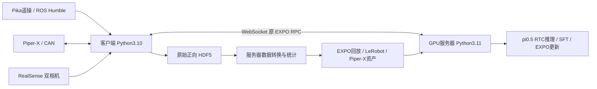

# 架构与数据约定

## 2026-10-30 已训练checkpoint配置补充

以下历史默认布局针对`piperx_pi05_lora_absolute_rtc`的初始绝对动作模型。新增`checkpoint_profile: piper_delta_right_wrist`用于接入此前训练好的四批30帧checkpoint：真实腕部进入`right_wrist_0_rgb`，左腕掩码False；replay和执行仍为米制绝对动作，VLA边界转为统一观测参考下的前6维delta。state统计保持原值，critic绝对动作统计与VLA原delta统计分开保存。不可只更换旧配置的权重路径。

新配置、流程和验证边界见独立文件`Real-Time-EXPO-FT完整训练流程.md`。成功检测采用实际夹爪宽度＋法兰高度＋闭合/保持目标＋连续实际动作步；不是视觉目标识别。本次只读正样本已测量，真实负例仍需现场验收。

## 进程与依赖



- 服务器监听，客户端主动连接。兼容原 `EnvClient` 的 create/reset/step/observation/info/render 操作；numpy 经上游 msgpack 序列化。
- 全部模型计算与梯度更新都在服务器；机器人端没有 JAX、Torch、DROID 依赖。
- 模型的慢推理由服务器原 `AsyncChunkSampler` 在线程中预取；客户端采集 RGB 的线程独立于动作 RPC。
- 主仓库只新增硬件、数据和启动适配；EXPO/OpenPI 的算法实现来自固定子模块。

## 状态和动作

- 状态与动作均为7维 `[x,y,z,roll,pitch,yaw,gripper_width]`，位置/夹爪为米，角度为弧度。
- pose 是机器人基坐标系中的绝对法兰目标；当前要求 `tool_offset_m=[0,0,0]`。不是速度，不是增量，不是夹爪开合概率。
- 原示教没有完整命令流，沿用参考转换器的近似：第 t 帧动作取第 t+1 帧反馈，末帧重复。这是复现假设，需要将来与真实控制延迟对照评估。
- 离线和在线图像均为两路 uint8 RGB，保持比例缩放并补黑边到224×224。在线 RealSense 底层输出 BGR，在适配层转 RGB。
- 为兼容 EXPO/OpenPI 张量命名，前视映射为 `exterior_image_1_left`，腕部映射为 `wrist_image_left`；模型第三路是掩码 False 的空视图。
- 模型配置单独注册为 `piperx_pi05_lora_absolute_rtc`。只复用 DROID 的纯张量布局/输出截断，不使用 DROID 控制器或速度统计。
- `task_config.env_type=droid` 是原训练入口选择 HDF5 reader 的兼容字段；`action_space=cartesian_position` 与 `gripper_action_space=position` 保证读取本项目的绝对动作。

## 数据文件

原始格式保留 collector 规范。EXPO 回放为 `<replay>/<数字>/traj.hdf5`，包含：

```text
saved_observation/cartesian_position  (T,6)
saved_observation/gripper_position    (T,1)
saved_observation/exterior_image_1_left (T,224,224,3)
saved_observation/exterior_image_2_left (T,224,224,3) #兼容repack
saved_observation/wrist_image_left    (T,224,224,3)
saved_observation/prompt              (T,)
action/cartesian_position            (T,6)
action/gripper_position              (T,)
timestamp                            (T,)
```

转换优先使用等长、时间偏差合规的 align 状态；否则按各自原始时间戳插值，拒绝外推/大间隙。检查轨迹长度、30Hz、中断、任务指令、RPY维度、NaN。只扫描正式 forward，排除 reverse/.staging。

原 EXPO reader 把每条离线示教末帧赋成功奖励1。因此输入必须人工核验成功；CLI 强制显式确认，不以“文件存在”判定任务成功。manifest 记录源路径与帧数；归一化 provenance 记录其 SHA256。

LeRobot 作为兼容导出继续调用 converter 子模块；当前主训练路径直接用 EXPO 回放，不要求先完成 LeRobot 转换或上传 Hugging Face。

## 执行边界

真实控制需填写现场工作空间、成功检测器，并传 `--allow-motion`。默认每个 episode 人工复位，不能把 DROID 的自动抛放动作迁到 Piper-X。

CAN/图像过期、动作不合法、看门狗超时或连接中断时停止保持并退出或锁定；不调用 disable 导致下坠，不自动 reset 清除急停。终止反馈后的多余 step 只返回保持状态。首次模型编译和人工复位期间不启动动作看门狗；首次动作后启用。

当前适配读取 collector 的内部 `_arm`、`_require_gripper` 和相机配置属性，固定版本已验证接口；未来升级采集子模块时需重新核对。真实设备控制质量、碰撞空间和通信恢复仍需现场验证。
