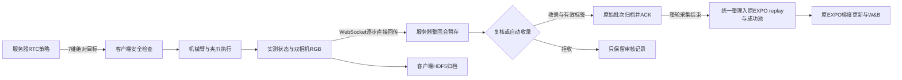

# 真机RL数据采集、转换与传输检查

更新：2026-11-02。本文持续维护检查合同；既有检查证据始于2026-10-31。范围为主工程适配、固定EXPO/OpenPI接口和新增浏览器客户端。软件检查与现场验收分别记录；真实策略回合/在线RL闭环尚无通过的验收记录。

2026-11-01补充：转换基准明确为data-transfer的OpenPI分支，图像统一OpenCV INTER_AREA和JPEG解码，离线RPY保留原值；论文/项目逐层表示及固定关节归位详见[表示合同](历史/数据与控制/2026-11-01_数据表示与固定归位核对.md)。

## 链路与数据含义

每回合有 $T$ 个实际发送目标 $a_0,\ldots,a_{T-1}$，以及 $T+1$ 个反馈观测 $o_0,\ldots,o_T$。第 $t$ 条经验对应执行前 $o_t$、实际下发 $a_t$ 和执行后的判定。观察到终止后不再下发策略动作。实际发送目标与反馈状态分别保存；不能因机器人尚未到位，就用反馈伪造“执行动作”。

动作是7维 `[x,y,z,rx,ry,rz,gripper_width]`：法兰绝对XYZ单位m，RPY单位rad，夹爪宽度单位m。不是速度、增量控制命令或夹爪闭合概率。控制前检查工作空间、单步平移/旋转、夹爪范围和步长，不静默裁剪训练动作。

## 三类数据入口

| 入口 | 对齐及转换 | 标签依据 | 使用边界 |
| --- | --- | --- | --- |
| 原采集HDF5→EXPO | `data/convert.py`检查forward、时间单调/覆盖与字段；按控制时间插值状态和匹配图像，动作由下一状态构造，末尾重复 | 必须显式确认全成功 | 只用于成功示教初始化 |
| 已有LeRobot→EXPO | `data/import_lerobot.py`读已有state/action和224 RGB视频，保留源动作、记录来源哈希 | 用户已确认batch2/3/4/5共394条成功 | 已生成44721帧正式示教和归一化资产 |
| GUI在线轨迹 | 不经过LeRobot；直接记录实际下发目标及对应观测，并逐步传输 | 自动标签＋可选人工覆盖＋收录开关 | 只由复核驱动入池，失败轨迹不会套用成功示教标签 |

原固定上游 `process_droid_dataset`把每条离线示教末帧设为奖励1；因此GUI文件采用独立UUID目录及`episode.hdf5`/`piperx_review_v1` schema，**不能直接喂给原全成功示教转换/读取命令**。新增服务端复核恢复也单独读取有明确标签的归档。当前没有提供将混合成败GUI档案导出为离线训练集的入口。

## 相机、状态与归一化检查

1. `PiperXDevices`复用原采集SDK。前视和右腕相机通过现场配置名称绑定；SDK输出BGR，执行端明确转RGB，再按比例缩放和黑边padding到224×224。
2. CAN状态检查时间戳新鲜度，当前反馈上限0.2s；图像后台线程保留最近帧，当前上限0.3s。相机缺帧、读取失败或反馈过期均停止控制。
3. 在线观测保留上游字段`exterior_image_1_left`和历史名称`wrist_image_left`；后者实际是Piper-X右腕。专用checkpoint适配映射到右腕模型槽位。`exterior_image_2_left`只是重复前视以满足接口，对应冗余模型视图被掩码。
4. replay、critic、RTC动作缓存采用绝对动作统计；仅在VLA边界，前6维按当前chunk参考状态转delta并使用原checkpoint统计，夹爪仍绝对宽度；输出再还原绝对目标。前缀重新锚定，避免原delta统计用于绝对动作。
5. 原state统计、绝对action统计、VLA原delta统计及来源哈希独立核验，避免混入DROID速度动作资产。此次没有修改算法变换或既有训练权重。

两路相机当前不是硬件同步采集；新鲜度检查也不证明两路曝光同时。GUI归档的monotonic时间是客户端组装观测/入队时刻，不是相机曝光时间，不能用于宣称硬件同步或精确传感延迟。真实相机错位、反馈落后以及模型到执行的p95延迟仍须现场测量。

`step`返回表示目标已交给SDK，并不表示机器人已经到达目标。后继观测在该调用之后读取，但目前没有要求每个CAN/相机源时间戳严格晚于该目标下发的屏障；通过新鲜度检查的反馈仍可能来自最近一次缓存。T/T+1保证记录与调用顺序，不证明物理响应已完成。正式采集前应测量反馈和图像相对下发时刻的滞后，再决定是否需要基于SDK时间戳的等待与同步，不能靠增加固定sleep猜测。

## 直接传输与一致性

- 学习器监听192.168.50.2:8103，机器人主动拨入；消息为原`msgpack_numpy`加WebSocket，保留TCP_NODELAY。图像以数组传输，GUI预览JPEG只用于浏览器，不会回写训练像素。
- 原协议核对任务指令、控制频率、episode长度、绝对动作规范。GUI额外协商`episode_review_v1`，允许客户端每回合设置最大步数；总采集预算由学习器控制，最后一步强制截断并收齐后继观测。
- 不在学习器和客户端同时累加控制sleep；学习器按30Hz节拍安排动作。浏览器轮询只读已有观测缓存，不从HTTP线程额外读取机器人或相机。
- 每个动作后恰好读取一次后继观测。双方以固定float32状态/动作和uint8双RGB分别累计SHA256，覆盖初始观测及全部动作/后继观测；复核时比对步数和摘要，不一致拒绝入池。辅助时间戳和备注不参与摘要。
- 断线时无法证明最后动作是否执行，故不重连、不重发；已发送但未收到后继观测的目标在中断元数据单独保留，不能冒充完整经验。

原CLI保留原驱动，并继续忽略其首次全零占位动作，终止后多余step只返回保持状态；GUI新驱动直接从reset观测启动，不发全零占位。

## 奖励、人工优先与经验准入

自动检测复用已配置规则：高度超过0.281807m、实际夹爪宽度34.6～38.6mm、目标没有要求张开，连续6个实际动作步满足才成功。重复获取观测不能增加连续计数。它不是视觉物体身份检测器，空夹及错误物体等负例仍需验收。

有效成功标签：

$$
s_{\mathrm{effective}}=\begin{cases}
s_{\mathrm{manual}}, & \text{存在人工标记}\\
s_{\mathrm{auto}}, & \text{否则}
\end{cases}
$$

收录后前 $T-1$ 步奖励0、mask1、done=False；末步奖励为 $s_{\mathrm{effective}}$，done=True。成功或人工明确失败时末步mask0；自动未检出且未人工改标的步数限制/提前结束保留mask1截断语义。固定上游replay会过滤触及截断的critic窗口，避免跨回合bootstrap。原始自动结果始终保留，训练不直接读取HDF5中的原始自动奖励列。

- 人工复核：整回合先暂存，确认前无replay插入、无成功池标记、无该条经验触发的更新。
- 自动收录：回合结束后自动生成“无人工覆盖、收录=True”的审核记录；后续原始归档ACK、整轮结束后入池的路径与人工模式相同。下一回合仍需现场复位确认。
- 拒收：不调用replay插入/成功池接口，不增加接受回合计数或更新额度；只保留客户端完整档案和服务器审核元数据。
- 空轨迹不入池；单条长度严格小于经验池容量，避免成功区间起止相同被误当作整个环形缓冲区。
- 累计10条收录回合作为暖启动门槛（第10条开始产生额度，前9条不追补）；整轮结束后按收录动作步数累计额度，每30步一次外层update，沿用原UTD=20、原actor/critic更新。拒收不触发积压额度。`rl_batch_size`仍独立为4，未把RTC-SFT batch32容量结论用于RL。

收录确认之后不提供回溯改标和撤回按钮，因为该条可能已参与梯度更新。需要人工优先标签时使用逐条复核模式。

## 落盘、ACK与恢复

客户端异步写HDF5，队列上限64项。控制期间非阻塞入队，积压超限或写盘失败就停止，不能丢帧后继续。回合结束且设备不再执行动作时等待写盘完成，将partial文件重命名为正式文件，再进入复核。JSON元数据用临时文件替换。

客户端文件包含：

| 字段 | 形状/含义 |
| --- | --- |
| `observations/state` | `(T+1,7)`反馈状态 |
| `observations/exterior_image_1_left` | `(T+1,224,224,3)`前视RGB |
| `observations/wrist_image_left` | 同上，实际右腕RGB |
| `actions` | `(T,7)`实际发送目标 |
| `auto_reward_mask_done_success` | `(T,4)`原始自动判定，不是最终训练标签 |
| `observation_monotonic_s` | `(T+1,)`客户端观测组装时刻 |
| `metadata.json` | 配置快照、摘要、自动/人工/有效标签、准入、备注、服务器ACK与轨迹曲线 |

采集期间服务端按审核结果写`checkpoints/collection_batches/<batch_id>/reviewed_episodes/<UUID>/`，接受时另有原始`transitions.pkl`，拒收只有元数据；临时目录改名后回传queued/rejected ACK。queued仅表示原始轨迹已应用层落盘，不表示入池、模型更新或checkpoint保存。达到预算或手动结束采集后逐条整理最终奖励/掩码，入池并写入`checkpoints/reviewed_episodes/<UUID>/`，再回传accepted确认；统一执行合格更新额度，整轮最后保存一次完整模型。不承诺断电时的磁盘硬件持久性。pickle仅用于应用自己生成的服务端文件，HTTP不接受pickle上传。

恢复使用模型实际保存step，只重放此前的已收录完整轨迹，并恢复更新额度/更新次数。超出模型step的服务端档案移动到`unrestored_episodes/`保留，不混入后续恢复。`collection_batches/`独立于模型恢复目录，未完成批次不会自动重放；客户端“已提交未确认”不能自动重发来猜测服务端状态。原CLI的`buffers/*.pkl`恢复逻辑保留，不混用两种目录。

## 检查记录与后续验收

2026-10-31的软件回环、标签覆盖、模拟归档与浏览器验收过程已移入[数据链路软件验收记录](历史/数据与控制/2026-10-31_数据链路软件验收.md)。最新已确认状态见[项目交接](项目交接.md)，后续现场负例、时间偏差、策略闭环、完整模型在线更新与成功率评估按[实验计划](实验计划.md)验收。

正式batch32 RTC-SFT在2026-11-01最后一次核对已正常退出；最终4000参数恢复/推理仍待验收。本文件维护检查合同，不用历史测试结果推断当前运行状态或真实运动质量。
